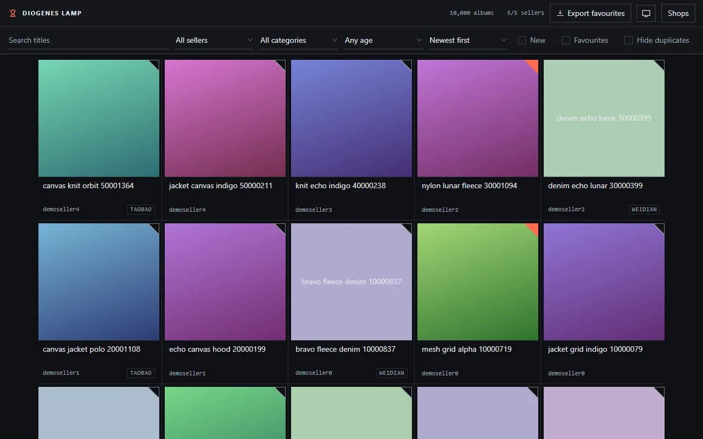

# DiogenesLamp

```
+----------------------------------------------------------------------+
|                             DiogenesLamp                             |
+----------------------------------------------------------------------+
|         Offline Yupoo catalogue archiver with a local viewer         |
+----------------------------------+-----------------------------------+
| DR  what it gives you            | CR  what it needs                 |
+----------------------------------+-----------------------------------+
| one page scroll all sellers      | Yupoo seller links CSV or text    |
| search and filter catalogues     | lamp scrape to fetch listings     |
| links back to Yupoo albums       | -                                 |
+----------------------------------+-----------------------------------+
```

[](https://github.com/ryanduguid/DiogenesLamp/actions/workflows/ci.yml)

Browse any Yupoo catalogue locally as one fast, searchable, infinite-scroll page.



*Synthetic demo data, generated by `tests/make_demo_data.py`. The covers are
gradients rather than photos; everything else is the real viewer.*

Yupoo seller catalogues paginate every 20-ish albums and load slowly. DiogenesLamp
scrapes the album covers, titles, and any taobao/tmall/weidian purchase links into
a local index once, then serves a single page where the whole catalogue - across all
your sellers - scrolls, searches, and filters locally. Clicking an item opens the
original Yupoo album for the detail photos.

## Install

Requires Python 3.11+. Install from a clone, and keep the clone: the
viewer is served straight out of the source tree, so the editable install
(`-e`) is required, not a convenience.

There are no tagged releases and none are planned: the clone is the
install, and the ci badge above is the release gate.

    git clone https://github.com/ryanduguid/DiogenesLamp
    cd DiogenesLamp
    pip install -e .

## Use

1. Put your Yupoo links in a text or CSV file, one URL per line (messy exports
   are fine - duplicates, page URLs, and non-Yupoo links are handled). Rows
   like `12,https://seller.x.yupoo.com` work too: a leading numeric index
   (comma- or tab-separated) is stripped, and the rest of the line is taken
   as the URL, so URLs that themselves contain commas survive intact.

       lamp import links.csv

   This creates or updates `sources.toml`. Non-Yupoo shop links (taobao,
   weidian, link aggregators) are kept as a link-out directory.

   To leave a seller out of scrapes - a catalogue too large to be worth the
   hours, say - add `skip = true` to its entry. Commenting it out would not
   last, since `lamp import` rewrites the file from your dump.

2. Scrape (the first run is slow by design - it rate-limits itself to stay
   polite; re-runs only fetch what changed):

       lamp scrape

   Big catalogues are mostly stale stock. Skipping listings older than 6
   months typically removes about two thirds of the work:

       lamp scrape --max-age-days 180

   Ages come from the album page's publish date, or from the album id where
   no date was captured (ids are sequential, so they date an album without
   costing a request - which is what lets the scrape skip a listing before
   fetching it). The flag decides what to fetch, not what to keep: albums
   already scraped stay in `data/`, and the viewer's age filter hides them.

   Other flags: `--seller <id>` for one seller, `--full` to re-fetch
   everything, `--dry-run` to count list-page work without fetching album
   pages or writing files, `--workers N` (default 8), `--rps N` (default 8.0, global
   request rate cap). Raising `--rps` alone does little: each seller host is
   held to 1 request/second, so more hosts have to be in flight for a higher
   cap to matter. Raise `--workers` with it.

   Incremental re-runs skip unchanged titles, but records written before
   price extraction (no `price` field on disk) are fetched once so catalogue
   prices can backfill. Use `--full` to re-fetch everything.

3. Browse:

       lamp serve

   `--port N` changes the port and `--no-browser` stops it opening one.
   Global options go *before* the subcommand: `lamp --data other-dir serve`
   and `lamp --sources other.toml scrape`.

   Search titles (press `/` to jump to the box), filter by seller, category or
   posting age, show only new-since-last-scrape items, and sort the whole
   catalogue by price, by photo count, or newest first. Titles and
   descriptions are scanned for a yuan price (`¥180`, `180元`, `P180`), and
   that is what the price sorts read. A search marks the parts of each title
   it matched, every term of it, so a hit says which part of it hit. Clicking
   a cover opens the original Yupoo album; the purchase links sit in the line
   beneath it.

   The folded corner at the top right of each cover is the favourite: click it
   to keep an album and it fills in. **Export favourites** writes the kept
   albums to a JSON file; it waits until every seller shard has loaded and
   names any it had to leave out. Favourites, your filter selection, the sort
   and the colour theme are all remembered in your browser, so a reload puts
   you back where you were. **Clear filters** resets them in one go, and the
   page is an installable PWA (`manifest.json`).

   The grid is a keyboard surface. Tab reaches one card - the one under the
   cursor, whose own cover link, star and purchase links follow it, while
   every other card is skipped - then the arrow keys move that cursor from
   cover to cover (Home, End, Page Up and Page Down included), Enter opens the
   album under the cursor, and `f` keeps it. The cursor scrolls the grid to
   follow itself, so it works the same at album 12 and album 40,000.

   The theme button cycles system, light and dark. Every control is labelled,
   Escape closes the shops panel or a duplicate group, and a skip link jumps
   past the head band to the grid.

   Two filters exist for large catalogues:

   - **hide duplicates** collapses repeat postings to one card with a `×N`
     badge. Click the badge and the grid becomes a strip: the copies stand
     side by side at a larger size, each carrying the seller and the date it
     was posted, which are the fields that differ. Escape leaves it, and you
     land back where you were browsing. Two albums count as the same posting
     when they share a taobao/tmall/weidian item id, or when one seller posted
     the same title twice. Titles never group across sellers - mirrored
     storefronts share album names, so that would merge distinct products.
   - **age** hides listings older than 30/90/180/365 days, whose stock is
     usually long gone.

## Data

Everything lives in `data/` (gitignored): `index.json`, per-seller shards in
`catalog/*.json`, and cover thumbnails in `thumbs/`. Delete `data/`
to start over. `sources.toml` is also gitignored - your seller list stays on
your machine.

## Politeness and scope

- Global cap of 8 requests/second by default (tune with --rps), 1
  request/second per seller host, honest User-Agent, backoff on errors, and a
  hard stop per seller if Yupoo answers 429/403 repeatedly.
- Covers and metadata only - detail photos are never downloaded; the viewer
  links back to Yupoo for those.
- HTML responses are limited to 8 MiB after decompression. Larger pages fail
  with a size-limit error.
- Public pages only. No login, no paywall, no captcha handling.

## Development

    pip install -e '.[dev]'   # quotes matter in zsh
    ruff check .
    pytest              # fixture-based, no network
    pytest -m manual    # canaries against saved live samples

The `manual` tests check the parsers against a real page saved by hand to
`data/debug/sample-list.html` - fetch a seller's `albums?page=1` there and the
canary says whether the selectors still match live Yupoo markup (the test's
docstring has the command). Nothing writes that file for you: a scrape only
dumps pages it *failed* to parse, which is the opposite of a canary. So on a
fresh clone they fail by design rather than pass vacuously.

The viewer is dependency-free vanilla JS with no build step - edit
`viewer/*.js` and reload. Its visual system is recorded in `DESIGN.md`
(tokens, named rules, component behaviour) and the product record it serves is
in `PRODUCT.md`; read `DESIGN.md` before changing anything in `viewer/`,
because the card geometry there is a contract `app.js` reads back out of the
stylesheet at runtime. Its logic modules have their own tests, run by
`pytest` through a wrapper (skipped when node is missing) and directly with:

    node --test tests/viewer/*.test.cjs

For strict type checking of the viewer's 6 logic modules and compile-only
contract tests, run `npm ci` then `npm run typecheck`. TypeScript and the Node
type declarations are development tools only; the check emits no files and
the browser still loads the same JavaScript. `app.js` and its DOM interactions
are outside this initial scope. `viewer/browser-globals.d.ts` gives the script
loading path the same helper signatures as the Node test imports.

To work on the viewer without scraping anything, generate synthetic data:

    python tests/make_demo_data.py demo-data
    lamp --data demo-data serve

That writes 5 sellers x 2000 albums, with generated gradient covers for 2
albums in every 3, spread across each seller. The rest are left cover-less
on purpose, so the viewer's titled colour-block fallback is on screen too.

Yupoo serves 2 different list-page templates and the parser handles both.
When a seller fails, the page is saved to `data/debug/<seller>-page1.html`
and the error distinguishes a page whose albums could not be read (a parser
problem) from one with no albums at all (an empty or closed seller).

MIT licensed.
