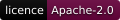
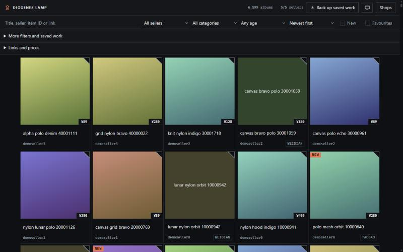

  <picture>
    <source media="(max-width: 600px) and (prefers-color-scheme: light)" srcset=".github/assets/banner-phone-light.svg">
    <source media="(max-width: 600px)" srcset=".github/assets/banner-phone.svg">
    <source media="(prefers-color-scheme: light)" srcset=".github/assets/banner-light.svg">
    
  </picture>

     
  
 

[Install](#install) · [Use](#use) · [Data](#data) · [Diagnostics](#diagnostics-and-recovery) · [Covers](#cached-covers-and-visual-suggestions) · [Politeness](#politeness-and-scope) · [Development](#development) · [Licence](#licence)

Browse any Yupoo catalogue locally as one fast, searchable, infinite-scroll page.

Yupoo seller catalogues paginate every 20 or so albums and load slowly. DiogenesLamp
scrapes the album covers, titles and any taobao, tmall or weidian purchase links into
a local index once, then serves a single page where the whole catalogue, across all
your sellers, scrolls, searches and filters locally. Clicking an item opens the
original Yupoo album for the detail photos.

  
   
  The viewer over synthetic demo data from <code>make_demo_data</code>; no real seller's images.

## Install

Requires a Rust toolchain (the version is pinned in `rust-toolchain.toml`).
`lamp` is a single binary with the viewer assets built in:

    git clone https://github.com/EquityBot/DiogenesLamp
    cd DiogenesLamp
    cargo install --locked --path .

No tagged release is required to install from the clone, and the installed
binary works outside the source tree. During development, `cargo run --` runs
the current source; viewer edits take effect at the next build.

## Use

1. Put your Yupoo links in a text or CSV file, one URL per line (messy exports
   are fine: duplicates, page URLs and non-Yupoo links are handled). Rows
   like `12,https://seller.x.yupoo.com` work too: a leading numeric index
   (comma- or tab-separated) is stripped, and the rest of the line is taken
   as the URL, so URLs that themselves contain commas survive intact.

       lamp import links.csv

   This creates or updates `sources.toml`. Non-Yupoo shop links (taobao,
   weidian, link aggregators) are kept as a link-out directory.

2. Scrape (the first run is slow by design: it rate-limits itself to stay
   polite, and re-runs fetch only what changed):

       lamp scrape

3. Browse:

       lamp serve

Flags, scrape behaviour and the viewer's features are in
[docs/reference.md](docs/reference.md).

## Data

Fetched data lives in `data/` (gitignored): `index.json`, seller shards in
`catalog/`, cached covers in `thumbs/` and run summaries in `runs/`. The seller
list stays in the gitignored `sources.toml`. Browser annotations are separate;
use **Back up saved work** to preserve them.

Metadata uses schema version 1. Existing unversioned shards remain readable.
Unsupported versions, malformed records and unsafe paths fail visibly.

New indexes list each seller's selected `album_ids` and map older IDs to the
selected IDs in `album_aliases`. Raw shards retain captures for refresh, history
and recovery. To rebuild an existing catalogue locally, run `lamp reindex` (or
`lamp --data path/to/data reindex`); it fetches nothing and preserves the scrape
timestamp. The viewer also selects the newest listings while loading an older
index. A failed selected shard does not make its older duplicates reappear.
Rebuilt indexes carry `selection_version: 1`. Canonical selection excludes
records whose links fail HTTPS, hostname or credential admission, preserving
the original captures. `doctor` reports their count as `unadmitted`.
Reindex can recover valid selected records beside excluded historical records;
missing, corrupt or ambiguous shards prevent replacement of the index.

Each album fetched since descriptions were kept carries `description`, the
album text cut at 500 characters (`description_truncated` marks a cut), after
the whole text has been read for links and prices. Records written earlier
have no such field; they gain one when their detail page is next fetched,
which the refresh budget does oldest first, so coverage grows with each
budgeted run. `--full` fetches everything, covers included, and is not a
description-only operation.

### Diagnostics and recovery

    lamp --data data doctor
    lamp --data data snapshot
    lamp --data data restore data/snapshots/<snapshot-name>.zip

`doctor` reads files without changing them. It reports invalid or missing
metadata, duplicate IDs, cover coverage, unknown prices, missing detail dates,
albums without a recorded description and recorded detail failures. It returns a non-zero exit code for structural
errors. It does not verify whether a remote listing or extracted price is current.

`snapshot` saves metadata only, excluding images, browser annotations, source
lists and debug captures. It requires every indexed shard to exist and pass
validation before creating an archive. Each archive is limited to 10,000 files and 256 MB
of uncompressed metadata. Snapshots accumulate in `data/snapshots/`; retain the
ones you need. Restore validates the whole archive before writing, preserves
the previous metadata in another archive and replaces the index last. Files
replace atomically one at a time; an interrupted restore may need to be repeated.
Previous corrupt bytes are retained for manual recovery but must be repaired
before they can pass snapshot validation. Unlisted files are left in place.

### Cached covers and visual suggestions

New downloaded covers are oriented and reduced to a maximum edge of 640 pixels.
Their format and transparency are preserved. Existing small
covers keep their bytes. Content hashes keep cache URLs stable across unchanged
detail refreshes.

    lamp --data data prepare-covers --limit 1000

This command processes cached covers locally, saves a metadata snapshot first
and reports byte counts and failures. Repeat it to process the next batch;
prepared covers are skipped. Resizing replaces the cached image with a smaller
copy, so preserve original images separately if you need them. Metadata snapshots
do not restore original cover pixels. The command makes no network requests.

The preview's **Similar covers (experimental)** compares local 64-bit difference
hashes after a scrape or cover preparation. It returns up to 8 suggestions within
8 bit differences, scans at most 100,000 loaded albums, skips uniform hashes and
supports dismissal. It never merges identities or affects duplicate filtering.
Shared photography can produce false positives; crops and different angles can
be missed. The threshold has synthetic regression coverage, not a measured
accuracy rate on real products.

## Politeness and scope

- Global cap of 8 requests/second by default (tune with `--rps`), 1
  request/second per seller host, honest User-Agent, backoff on errors,
  `Retry-After` honoured on 429 and 503 (waiting at most 60 seconds each time),
  and a hard stop per seller if Yupoo answers 429/403 repeatedly.
- Covers and metadata only: detail photos are never downloaded, and the viewer
  links back to Yupoo for those.
- HTML responses are limited to 8 MiB after decompression. Larger pages fail
  with a size-limit error.
- Public pages only. No login, no paywall, no captcha handling.
- The viewer makes no request beyond this machine. Agent links are built
  locally from item IDs, and the optional QC photo lookup is a plain link
  that reaches rep.tools only when you follow it.

## Development

    cargo fmt --check
    cargo clippy --all-targets -- -D warnings
    cargo test                    # fixture-based, no network
    cargo test -- --ignored       # canary against a saved live sample

The ignored test checks the parsers against a real page saved by hand to
`data/debug/sample-list.html`: fetch a seller's `albums?page=1` there and the
canary says whether the selectors still match live Yupoo markup (the test's
comment has the command). Nothing writes that file for you: a scrape only
dumps pages it *failed* to parse, which is the opposite of a canary. So on a
fresh clone it fails by design rather than passes vacuously.

The tests need node: they run the viewer suite and check the scraper's
duplicate, URL and age rules against the viewer's own code, and they fail
rather than skip when node is missing.

The viewer is dependency-free vanilla JS with no build step: edit
`viewer/*.js` and reload. Its visual system is recorded in `DESIGN.md`
(tokens, named rules, component behaviour) and the product record it serves is
in `PRODUCT.md`; read `DESIGN.md` before changing anything in `viewer/`,
because the card geometry there is a contract `app.js` reads back out of the
stylesheet at runtime. Its logic modules have their own tests, run by
`cargo test` and directly with:

    node --test tests/viewer/*.test.cjs

For strict type checking of the viewer's logic modules, controllers and compile-only
contract tests, run `npm ci` then `npm run typecheck`. TypeScript and the Node
type declarations are development tools only; the check emits no files and
the browser still loads the same JavaScript. `viewer/controller-types.d.ts`
describes catalogue state and the elements owned by `index.html`; a Node test
checks the declared element IDs and tags. `viewer/browser-globals.d.ts` gives the
script loading path the same helper signatures as the Node test imports.
Compiler checks cover saved-value reads, DOM access and controller calls;
browser verification still checks focus, layout and keyboard behaviour.

To work on the viewer without scraping anything, generate synthetic data:

    cargo run --example make_demo_data -- demo-data
    lamp --data demo-data serve

That writes 5 sellers × 2,000 albums, with generated gradient covers for 2
albums in every 3, spread across each seller. The rest are left cover-less
on purpose, so the viewer's titled colour-block fallback is on screen too.
Fixtures include known and unknown prices, changed prices and gone listings.
For a larger metadata fixture with fewer generated images:

    cargo run --example make_demo_data -- demo-data-100k 10 10000 100

The final argument limits generated covers per seller. Use synthetic data to
check previews, cross-tab saves, backup/import, Back navigation and keyboard
focus at narrow and desktop widths. To verify packaging:

    cargo build --locked --release

Run the resulting binary from a directory outside the clone and check that the
page, scripts and styles return successfully; `cargo test` checks that every
asset `index.html` loads is built into the binary.

Yupoo serves 2 different list-page templates and the parser handles both.
Every listing page is checked for at least 3 distinct album links the parser
did not read. Such a page fails the seller as a possible layout change before
it can end the listing and mark cached albums gone, and is saved to
`data/debug/<seller>-pageN.html` (dry runs save nothing). An empty first page
without such links reports an empty or closed seller. The threshold can miss
fewer unread links; synthetic tests do not establish real-site coverage.
A listing that ends with 5 or more known albums missing, such as an empty
later page from a soft block, marks none of them gone or resolved and reports
an error. The next run marks an album gone only if it is missing again and
that run is not aborted by blocking; the same truncation twice in a row still
marks the albums it misses gone. A
truncated listing that misses fewer albums still marks them gone until they
are listed again.

## Licence

Apache-2.0; see [LICENSE](LICENSE). If you redistribute this work or build on it, keep the attribution in [NOTICE](NOTICE).

The banner's lettering and emblem are drawn from Cascadia Mono and Besley glyphs (SIL OFL 1.1).

---

Still looking for an honest seller. Made by <a href="https://github.com/EquityBot">EquityBot</a>. <i>Ad gloriam eius, non meam.</i>

